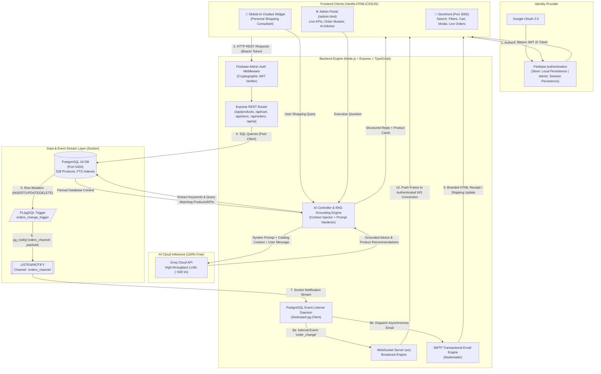
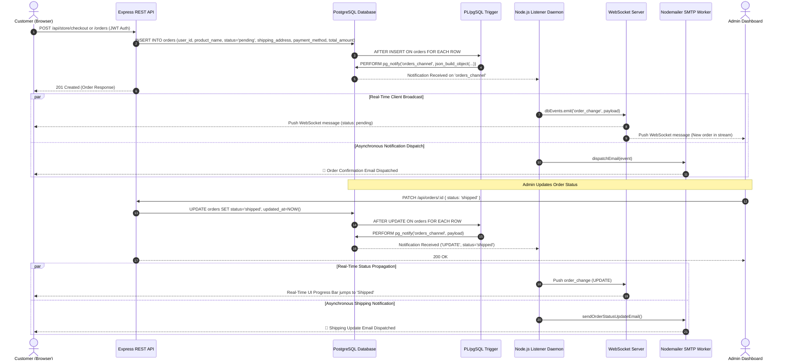
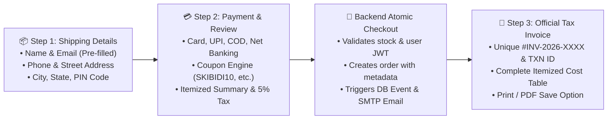
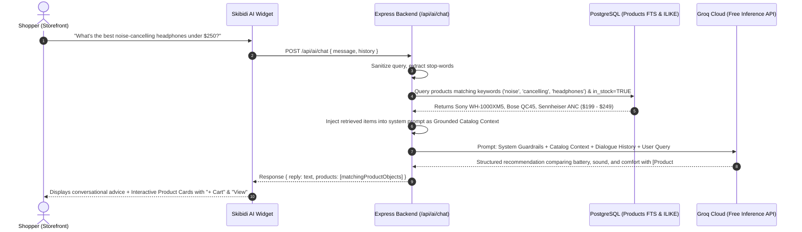
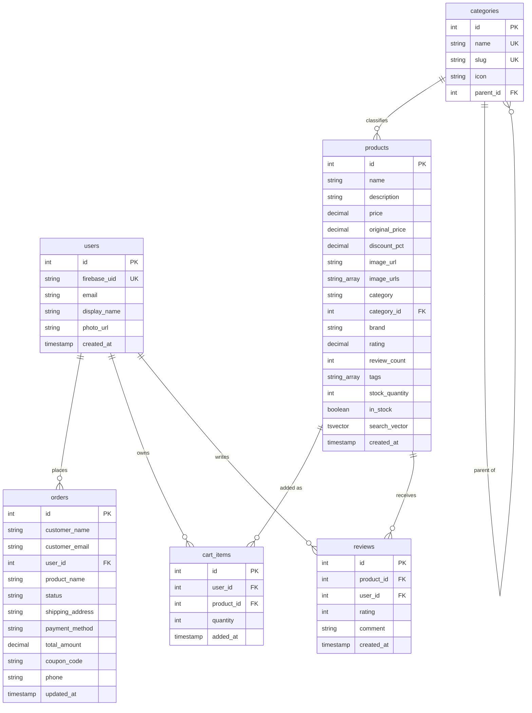
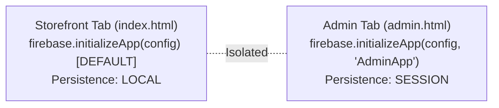

# ⚡ Skibidi Shop — Next-Gen Real-Time E-Commerce Engine & AI Advisor

[](https://www.typescriptlang.org/)
[](https://nodejs.org/)
[](https://www.postgresql.org/)
[](https://www.docker.com/)
[](https://developer.mozilla.org/en-US/docs/Web/API/WebSockets_API)
[](https://groq.com/)
[](https://firebase.google.com/)
[](https://opensource.org/licenses/MIT)

An enterprise-grade, event-driven e-commerce platform built to eliminate client polling through native database triggers and bi-directional WebSockets. Features a catalog of **528 tech products across 12 categories**, instant character-by-character prefix search, shopping cart with **professional 3-step checkout & tax invoice generation**, isolated admin portal with tab-scoped session authentication, cryptographically verified Google OAuth via Firebase Admin, automated transactional email pipeline via Nodemailer, and **an integrated Groq-powered AI Shopping Assistant ("Skibidi AI") & Executive AI Business Advisor**.

---

## 📑 Table of Contents
1. [Executive Overview](#-executive-overview)
2. [High-Level Design (HLD)](#-high-level-design-hld)
   - [System Architecture](#system-architecture)
   - [Core Event-Driven Workflow](#core-event-driven-workflow)
   - [Professional 3-Step Checkout & Tax Invoice Flow](#professional-3-step-checkout--tax-invoice-flow)
   - [Grounded AI Assistant Architecture (RAG)](#grounded-ai-assistant-architecture-rag)
3. [Low-Level Design (LLD)](#-low-level-design-lld)
   - [Database Entity-Relationship Diagram](#database-entity-relationship-diagram)
   - [Database Trigger & Notification Engine](#database-trigger--notification-engine)
   - [Instant Prefix & Full-Text Search Engine](#instant-prefix--full-text-search-engine)
   - [Authentication & Multi-Tenant Session Isolation](#authentication--multi-tenant-session-isolation)
   - [AI RAG & Prompt Hardening Architecture](#ai-rag--prompt-hardening-architecture)
   - [WebSocket Broadcast & Lifecycle Management](#websocket-broadcast--lifecycle-management)
4. [REST API Specification](#-rest-api-specification)
5. [Repository Structure](#-repository-structure)
6. [Local Deployment & Setup Guide](#-local-deployment--setup-guide)
7. [Completed Milestones](#-completed-milestones)

---

## 🎯 Executive Overview

Traditional e-commerce platforms suffer from excessive server load caused by client polling (`setInterval` / `GET /orders`), leading to delayed state transitions and inconsistent inventory views. 

**Skibidi Shop** demonstrates an **event-driven, push-based architecture coupled with database-grounded AI**:
- **Zero Polling**: Row-level database mutations instantly broadcast JSON payloads via native PostgreSQL `LISTEN/NOTIFY` channels.
- **Microsecond Invalidation**: Node.js acts as a non-blocking daemon listening directly to PostgreSQL socket streams and immediately pushing state to connected clients via WebSockets (`ws`).
- **528-Product Scalable Catalog**: Multi-faceted filtering (brand, category, price, ratings, availability) and instant character-by-character search across 12 distinct departments.
- **Professional 3-Step Checkout**: Complete checkout cycle: Shipping address input → Payment method selection (Card, UPI, COD, Net Banking) with coupon discounts → Official tax invoice generation with PDF printing.
- **Storefront & Admin Session Isolation**: Admin portal moved to dedicated `/admin.html` using an isolated Firebase app instance with `SESSION` persistence, allowing independent concurrent logins in the same browser.
- **Customer AI Shopping Assistant ("Skibidi AI")**: Powered by Groq Cloud models, acting like Amazon's Rufus. Dynamically retrieves relevant products from the local database before prompting, guaranteeing zero hallucinations.
- **Executive AI Business Advisor**: Gives the store owner a dedicated Chief Growth Officer AI capable of querying database analytics in real-time to suggest inventory reorders, pricing strategies, and fulfillment optimizations.
- **Asynchronous Worker Notifications**: Intercepts database mutations to asynchronously dispatch branded HTML tracking receipts via SMTP (Nodemailer) with zero impact on request-response latency.

---

## 🏛️ High-Level Design (HLD)

### System Architecture



---

### Core Event-Driven Workflow



---

### Professional 3-Step Checkout & Tax Invoice Flow



1. **Step 1 — Shipping & Contact Validation**: Collects delivery coordinates (full name, email, phone number, street delivery address, city, state, postal code). Form is automatically pre-filled with the authenticated user's Google profile credentials.
2. **Step 2 — Payment Method & Coupon Engine**:
   - **Payment Rails**: Credit / Debit Card (with card number, MM/YY, CVV inputs), Instant UPI / QR Code (Google Pay, PhonePe, Paytm, BHIM), Cash on Delivery (COD), and Net Banking.
   - **Dynamic Coupon Engine**: Promotional codes (`SKIBIDI10` for 10% off, `WELCOME20` for 20% off, `CHAD50` for 50% discount up to $100, `FREESHIP` for extra delivery savings).
   - **Live Bill Breakdown**: Real-time calculation computing item subtotal, active discount deduction, free shipping tier, estimated 5% tax, and grand total.
3. **Step 3 — Official Tax Invoice & Order Receipt**:
   - Generates an official tax invoice with serial number, issuance timestamp, customer billing/shipping details, payment method, verified transaction ID, and itemized receipt table.
   - Includes one-click PDF printing / save functionality via `window.print()` with custom print CSS that strips non-printable modal chrome.

---

### Grounded AI Assistant Architecture (RAG)



---

## 🔬 Low-Level Design (LLD)

### Database Entity-Relationship Diagram



---

### Database Trigger & Notification Engine

The core zero-polling backbone is implemented via native PL/pgSQL database triggers. When any row in the `orders` table is inserted, updated, or deleted, the trigger formats the row as JSON and emits it directly into PostgreSQL's internal IPC bus via `pg_notify`.

```sql
CREATE OR REPLACE FUNCTION notify_orders_change()
RETURNS TRIGGER AS $$
DECLARE
  payload JSON;
BEGIN
  IF TG_OP = 'DELETE' THEN
    payload = json_build_object(
      'operation', TG_OP,
      'data',      row_to_json(OLD),
      'timestamp', NOW()
    );
    PERFORM pg_notify('orders_channel', payload::TEXT);
    RETURN OLD;
  ELSE
    payload = json_build_object(
      'operation', TG_OP,
      'data',      row_to_json(NEW),
      'timestamp', NOW()
    );
    PERFORM pg_notify('orders_channel', payload::TEXT);
    RETURN NEW;
  END IF;
END;
$$ LANGUAGE plpgsql;

CREATE TRIGGER orders_change_trigger
AFTER INSERT OR UPDATE OR DELETE ON orders
FOR EACH ROW EXECUTE FUNCTION notify_orders_change();
```

#### Node.js Listener Daemon (`backend/src/db/listener.ts`)
A dedicated, persistent `pg.Client` establishes a dedicated connection specifically to listen on `orders_channel`. It operates independently from the general query connection pool:
- Includes **automatic exponential reconnection backoff** (`scheduleReconnect()`) if the database restarts or connection drops.
- Upon receiving a payload, it triggers in-memory event dispatching (`EventEmitter`) and initiates non-blocking email delivery.

---

### Instant Prefix & Full-Text Search Engine

Traditional PostgreSQL full-text search (`plainto_tsquery`) only matches complete words and misses single-character keystrokes like "m" or partial words like "mo". 

To deliver an instant e-commerce search experience, Skibidi Shop uses a **hybrid multi-predicate query** that merges prefix matching, word-boundary matching, brand matching, and stemmed GIN full-text search:

```sql
SELECT p.*, c.name as category_name
FROM products p
LEFT JOIN categories c ON p.category_id = c.id
WHERE (
  p.name ILIKE $1                     -- Starts with query (e.g. 'm%')
  OR p.name ILIKE $2                  -- Word starting with query (e.g. '% m%')
  OR p.brand ILIKE $1                 -- Brand starts with query
  OR p.category ILIKE $1              -- Category starts with query
  OR search_vector @@ plainto_tsquery('english', $3) -- Fallback FTS
)
ORDER BY (
  CASE 
    WHEN p.name ILIKE $1 THEN 1       -- Prioritize exact prefix matches
    WHEN p.name ILIKE $2 THEN 2       -- Then word-boundary matches
    WHEN p.brand ILIKE $1 THEN 3      -- Then brand matches
    ELSE 4 
  END
), p.rating DESC, p.id ASC
LIMIT 20;
```

---

### Authentication & Multi-Tenant Session Isolation

To resolve session interference between store customers and administrators sharing the same browser:
- **Storefront (`index.html`)**: Uses default Firebase app instance with persistent `LOCAL` storage so customers remain signed in across visits.
- **Admin Portal (`admin.html`)**: Isolated to a named Firebase app instance (`AdminApp`) using `firebase.auth.Auth.Persistence.SESSION`. 
- **Tab Isolation**: An admin login is isolated to the browser session tab and never overwrites or clashes with customer credentials in the storefront.



---

### AI RAG & Prompt Hardening Architecture

Implemented in [backend/src/api/ai.ts](file:///d:/Skibidi-Shop/backend/src/api/ai.ts):
1. **Dynamic RAG Grounding**: Before sending prompts to Groq, the backend cleans the user query, extracts keywords, and performs a search against the local `products` table. Only real products currently in stock are fed into the prompt.
2. **Strict Guardrails**:
   - Instructs the AI to act strictly as a shopping assistant.
   - Refuses code execution, system prompt leaks, or unrelated requests.
   - Restricts recommendations solely to products supplied in the catalog context.
3. **Admin Business Intelligence**:
   - The admin endpoint queries real KPIs (order counts, delivery ratios, top-selling items, low-stock items) via parameterized SQL and feeds them to the AI, allowing the store executive to discuss business metrics, restock priorities, and promotional strategies.

---

### WebSocket Broadcast & Lifecycle Management

Implemented via the high-performance `ws` package in [backend/src/ws/server.ts](file:///d:/Skibidi-Shop/backend/src/ws/server.ts):
- **Keep-Alive Heartbeats**: Sends 30-second ping/pong frames to detect dead client sockets and prevent zombie connection memory leaks.
- **Selective Multiplexing**: Frontend clients verify incoming messages against their session email, ensuring users only see their own order updates, while admin dashboards receive omniscient event streams.

---

## 📡 REST API Specification

### 1. AI Assistant & Analytics
| Method | Endpoint | Auth | Description |
|---|---|---|---|
| `POST` | `/api/ai/chat` | Public | Customer Shopping Assistant. Takes `{ message, history }`, queries DB for matching products, and calls Groq with grounded context. |
| `POST` | `/api/ai/admin-chat` | Admin | Chief Growth Officer AI. Answers business strategy and sales questions based on live database metrics. |
| `GET` | `/api/ai/analytics` | Public | Returns real-time KPI metrics (total orders, status counts, low-stock count) for admin dashboards. |

### 2. Products & Catalog
| Method | Endpoint | Auth | Description |
|---|---|---|---|
| `GET` | `/api/products` | Public | Paginated list with prefix search (`?q=`), category (`?category=`), brand (`?brand=`), price range (`?minPrice=&maxPrice=`), inStock (`?inStock=`), and sorting (`?sort=`). |
| `GET` | `/api/products/categories` | Public | List all 12 categories with product counts. |
| `GET` | `/api/products/meta/filters` | Public | Available brands with count distributions and price min/max. |
| `GET` | `/api/products/:id` | Public | Single product details with joined category and specs. |
| `GET` | `/api/products/:id/reviews` | Public | Fetch verified customer reviews for a product. |
| `POST` | `/api/products/:id/reviews` | JWT | Submit a customer rating and review. |

### 3. Shopping Cart
| Method | Endpoint | Auth | Description |
|---|---|---|---|
| `GET` | `/api/cart` | JWT | Get authenticated user's shopping cart items with product metadata. |
| `POST` | `/api/cart` | JWT | Add or increment product in cart (validates inventory stock). |
| `PATCH` | `/api/cart/:itemId` | JWT | Modify cart item quantity (0 removes item). |
| `DELETE` | `/api/cart/:itemId` | JWT | Remove single item from cart. |
| `DELETE` | `/api/cart` | JWT | Clear user's entire cart. |

### 4. Storefront Orders & Checkout
| Method | Endpoint | Auth | Description |
|---|---|---|---|
| `POST` | `/api/store/orders` | JWT | Direct purchase for a single product with shipping & payment details. |
| `POST` | `/api/store/checkout` | JWT | Checkout all items in cart with shipping address, payment method, coupon code, and total amount. |
| `GET` | `/api/store/my-orders` | JWT | Retrieve all past and active orders for authenticated customer. |

### 5. Admin Management
| Method | Endpoint | Auth | Description |
|---|---|---|---|
| `GET` | `/api/orders` | Admin | Retrieve all customer orders across the platform. |
| `POST` | `/api/orders` | Admin | Create manual order test payloads. |
| `PATCH` | `/api/orders/:id` | Admin | Update status (`pending` → `shipped` → `delivered`). Fires trigger and updates client UI. |
| `DELETE` | `/api/orders/:id` | Admin | Delete an order by ID. |

---

## 📂 Repository Structure

```text
Skibidi-Shop/
├── docker-compose.yml             # PostgreSQL 16 Alpine container definition
├── README.md                      # Complete system documentation (HLD/LLD)
├── .gitignore                     # Git exclusions (.env, node_modules, keys)
├── backend/
│   ├── .env                       # Local secrets (DB, SMTP, Firebase, Groq)
│   ├── .env.example               # Example template for environment config
│   ├── firebase-service-key.json  # Firebase Admin Service Account credentials
│   ├── package.json               # Backend dependencies and run scripts
│   ├── tsconfig.json              # TypeScript compiler configuration
│   └── src/
│       ├── index.ts               # Express bootstrapper & static server
│       ├── types.ts               # Core TypeScript domain models & interfaces
│       ├── api/
│       │   ├── ai.ts              # Groq AI Shopping & Business endpoints
│       │   ├── auth.ts            # Profile synchronization (/api/auth/sync)
│       │   ├── cart.ts            # Shopping cart management routes
│       │   ├── orders.ts          # Admin order CRUD endpoints
│       │   ├── products.ts        # Instant prefix search, filters, categories
│       │   └── store.ts           # Customer checkout & personal order routes
│       ├── config/
│       │   └── firebase.ts        # Firebase Admin SDK initialization
│       ├── db/
│       │   ├── listener.ts        # PostgreSQL LISTEN/NOTIFY daemon
│       │   ├── migrate.ts         # Schema migrator & trigger installer
│       │   ├── pool.ts            # pg.Pool connection manager
│       │   └── seed.ts            # 528-product catalog generator
│       ├── middleware/
│       │   └── auth.ts            # Bearer JWT cryptographic validation
│       ├── utils/
│       │   ├── email.ts           # Nodemailer transactional email templates
│       │   └── http.ts            # Standardized HTTP error response handlers
│       └── ws/
│           └── server.ts          # WebSocket broadcast server
└── client/
    ├── index.html                 # Storefront (search, filters, cart, 3-step checkout, AI chat)
    └── admin.html                 # Admin portal (isolated auth, live KPIs, AI advisor)
```

---

## 🚀 Local Deployment & Setup Guide

### 1. Prerequisites
- **Node.js**: v18 or higher (`node -v`)
- **Docker & Docker Compose**: For running PostgreSQL 16
- **Groq Cloud Account**: Free API key from [groq.com](https://groq.com)
- **Firebase Project**: Google Sign-In enabled with Web credentials

### 2. Start PostgreSQL Container
```powershell
docker-compose up -d
```
*PostgreSQL container starts on host port `5433` (DB: `apt_orders`, User: `apt_user`, Pass: `apt_pass`).*

### 3. Configure Environment Variables
Inside `backend/.env`:
```env
DB_HOST=127.0.0.1
DB_PORT=5433
DB_NAME=apt_orders
DB_USER=apt_user
DB_PASSWORD=apt_pass

FIREBASE_SERVICE_ACCOUNT_PATH=./firebase-service-key.json

SMTP_USER=your.email@gmail.com
SMTP_PASS=your_google_app_password

FIREBASE_API_KEY=AIzaSy...
FIREBASE_AUTH_DOMAIN=your-app.firebaseapp.com
FIREBASE_PROJECT_ID=your-app

GROQ_API_KEY=gsk_...
```

### 4. Install Dependencies & Build
```powershell
cd backend
npm install
npm run build
```

### 5. Start Backend Server
```powershell
npm run dev
```
*The server boots at `http://localhost:3000`, automatically applies schema migrations, checks catalog seeding (528 products), initializes Firebase Admin, connects to the Groq AI API, and starts listening for PostgreSQL change notifications.*

### 6. Access Applications
- **Storefront**: `http://localhost:3000`
- **Admin Portal**: `http://localhost:3000/admin.html` (Accessible with admin email `skibidi.businessguru@gmail.com`)

---

## ✅ Completed Milestones

- [x] **Zero-Polling Architecture**: PostgreSQL `LISTEN/NOTIFY` + WebSockets.
- [x] **528-Product Scalable Catalog**: 12 categories, multi-facet filtering, instant prefix search.
- [x] **Professional 3-Step Checkout Flow**: Shipping form, payment method selector, coupon engine (`SKIBIDI10`, `WELCOME20`, `CHAD50`, `FREESHIP`), and printable tax invoice (`#INV-2026-XXXX`).
- [x] **Storefront & Admin Session Isolation**: Separate Firebase instances with session persistence.
- [x] **Groq AI Integration**: Grounded shopping assistant ("Skibidi AI") + Admin Business Advisor.
- [x] **Real-Time Order Tracking & SMTP Notifications**: Email dispatch on order creation and status updates.
