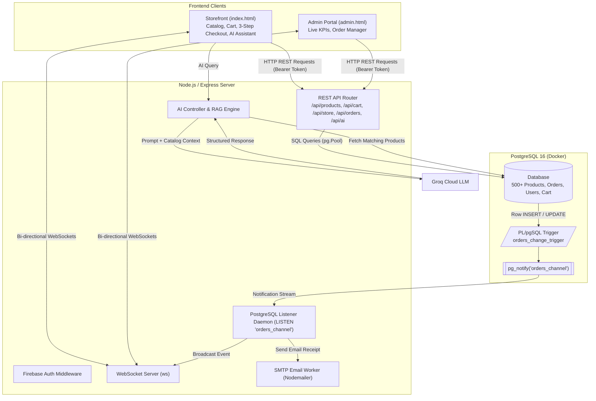
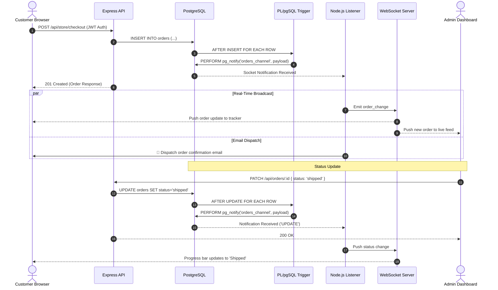
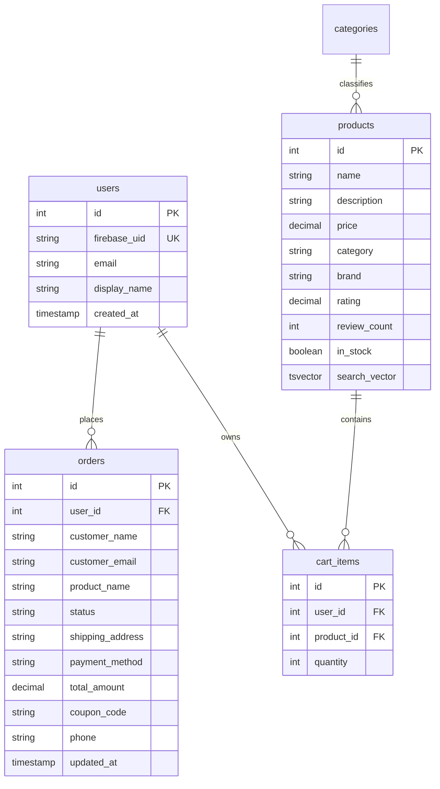

# ⚡ Skibidi Shop

A full-stack, real-time e-commerce application built with Node.js, Express, TypeScript, PostgreSQL, WebSockets, and Groq AI. 

Instead of traditional client polling, Skibidi Shop uses native PostgreSQL `LISTEN/NOTIFY` triggers and bi-directional WebSockets to push order updates and status changes to clients in real-time.

---

## ✨ Features

- **Real-Time Order Tracking**: Row-level database triggers (`LISTEN/NOTIFY`) propagate status changes (`pending` → `shipped` → `delivered`) instantly over WebSockets without client polling.
- **500+ Product Catalog**: Over 500 tech items across 12 categories with dynamic filtering (category, brand, price range, in-stock status, customer ratings).
- **Instant Prefix Search**: Fast search using PostgreSQL `ILIKE` prefix matching and `tsvector` full-text search, matching instantly on single keystrokes (`m` → `mo` → `motorola`).
- **3-Step Checkout Flow**: Complete checkout cycle with customer delivery coordinates, payment method selection (Card, UPI, COD, Net Banking), coupon engine (`SKIBIDI10`, `WELCOME20`, `CHAD50`, `FREESHIP`), and a printable tax invoice with PDF export.
- **AI Shopping Assistant**: An in-browser chatbot powered by Groq Cloud. Product recommendations are grounded directly in database inventory to prevent hallucinations.
- **Admin Dashboard**: A dedicated, tab-scoped admin portal (`/admin.html`) with live order status controls, business KPIs, and sales analytics.
- **Transactional Emails**: Asynchronous order confirmation and delivery status dispatch using Nodemailer via SMTP.
- **Google OAuth Authentication**: Secure token verification using Firebase Admin SDK with session persistence isolation between customer and admin logins.

---

## 🛠️ Tech Stack

| Layer | Technologies |
|---|---|
| **Backend** | Node.js, Express, TypeScript, `pg` (node-postgres), `ws` (WebSockets) |
| **Frontend** | Vanilla JavaScript (ES6+), HTML5, CSS3 Glassmorphism |
| **Database** | PostgreSQL 16 (Dockerized), PL/pgSQL Triggers, Full-Text Search |
| **AI Inference** | Groq Cloud API |
| **Authentication** | Firebase Authentication (Google OAuth 2.0), Firebase Admin SDK |
| **Email** | Nodemailer (SMTP) |

---

## 📐 System Architecture

### High-Level Architecture



---

### Real-Time Event Flow



---

## 🗄️ Database Schema



---

## 🚀 Getting Started

### 1. Prerequisites
- [Node.js](https://nodejs.org/) (v18+)
- [Docker & Docker Compose](https://www.docker.com/)
- A free API key from [Groq Cloud](https://groq.com)
- Firebase Project with Google Authentication enabled

### 2. Clone and Setup
```bash
git clone https://github.com/Yashraaj1205/Skibidi-Shop.git
cd Skibidi-Shop
```

### 3. Start Database
```bash
docker-compose up -d
```
*PostgreSQL starts on port `5433` (User: `apt_user`, Pass: `apt_pass`, DB: `apt_orders`).*

### 4. Configure Environment
Copy `.env.example` to `.env` inside `backend/`:
```bash
cp backend/.env.example backend/.env
```
Update `backend/.env` with your credentials:
```env
DB_HOST=127.0.0.1
DB_PORT=5433
DB_NAME=apt_orders
DB_USER=apt_user
DB_PASSWORD=apt_pass

FIREBASE_SERVICE_ACCOUNT_PATH=./firebase-service-key.json

SMTP_USER=your_email@gmail.com
SMTP_PASS=your_google_app_password

FIREBASE_API_KEY=AIzaSy...
FIREBASE_AUTH_DOMAIN=your-app.firebaseapp.com
FIREBASE_PROJECT_ID=your-app

GROQ_API_KEY=gsk_...
```

### 5. Install & Run
```bash
cd backend
npm install
npm run dev
```

The app will be available at:
- **Storefront**: `http://localhost:3000`
- **Admin Portal**: `http://localhost:3000/admin.html`

---

## 📡 API Reference

### Products
- `GET /api/products` — Paginated product search, filtering, and sorting
- `GET /api/products/categories` — List all categories with product counts
- `GET /api/products/:id` — Single product details

### Cart
- `GET /api/cart` — Get current user's cart items
- `POST /api/cart` — Add product to cart
- `PATCH /api/cart/:itemId` — Update item quantity
- `DELETE /api/cart/:itemId` — Remove item from cart

### Orders & Checkout
- `POST /api/store/orders` — Direct single-item order placement
- `POST /api/store/checkout` — Multi-item cart checkout with shipping and payment details
- `GET /api/store/my-orders` — Customer order history

### Admin
- `GET /api/orders` — View all orders
- `PATCH /api/orders/:id` — Update order status (`pending` → `shipped` → `delivered`)
- `GET /api/ai/analytics` — Business KPIs and inventory analytics

### AI Assistant
- `POST /api/ai/chat` — Grounded shopping assistant chat
- `POST /api/ai/admin-chat` — Business metrics advisor chat

---

## 📄 License

This project is licensed under the MIT License.
